# ClinAura | Health Monitoring & Doctor Channeling System

## Project Overview

**ClinAura** is an academic full-stack healthcare application project developed to improve personal health information management, symptom awareness, and doctor appointment coordination.

The project combines modern web development, relational database design, machine learning, business intelligence, and structured software engineering practices.

ClinAura's documented system supports three primary user roles: **Patient, Doctor (General Physician), and Administrator**.

The project integrates an AI-assisted symptom checker using a Python-based Logistic Regression model to generate category-based, non-diagnostic advisory insights.

**Project Type:** Final Academic Software Development Project  
**Academic Module:** FC6P01 Project  
**Frontend:** React.js, JavaScript  
**Backend:** C#, ASP.NET Core Web API  
**Database:** Microsoft SQL Server, Entity Framework Core  
**Machine Learning:** Python, Logistic Regression  
**Analytics:** Power BI  
**Project Management:** Agile methodology  
**Status:** Academic prototype and implementation portfolio

> **Medical disclaimer:** ClinAura is an academic demonstration project, not a clinically validated medical application. Its symptom predictions are advisory and must not be used for diagnosis, treatment decisions, or emergency triage.

---

## 1. Business Problem

Patients often face difficulties managing fragmented personal health information, documenting recurring symptoms, and coordinating medical consultations.

Common challenges include:

- Medical documents stored across multiple locations.
- Limited access to organized personal health histories.
- Difficulty tracking recurring symptoms.
- Inconsistent communication between patients and healthcare providers.
- Inefficient doctor appointment management.
- Limited visibility into health monitoring trends.
- Challenges interpreting medical information without professional assistance.

ClinAura explores how an integrated digital platform can support structured health monitoring and more organized consultation workflows.

---

## 2. Project Objectives

The project aimed to:

1. Develop a web-based health monitoring platform.
2. Support patient registration and profile management.
3. Organize medical documents and personal health information.
4. Implement a machine learning-based symptom checker.
5. Produce interpretable, category-based advisory predictions.
6. Support General Physician appointment requests and status monitoring.
7. Provide doctor-facing consultation workflows.
8. Enable administrator management and operational monitoring.
9. Develop analytical dashboards for system oversight.
10. Apply structured project management, feasibility assessment, system design, and testing practices.

---

## 3. Technologies and Tools

| Technology | Purpose |
|---|---|
| React.js | Frontend development |
| JavaScript | Client-side application logic |
| HTML and CSS | User interface design |
| ASP.NET Core Web API | Backend API development |
| C# | Server-side application logic |
| Microsoft SQL Server | Relational data storage |
| Entity Framework Core | Database access and migrations |
| Python | Machine learning development |
| Logistic Regression | Symptom-category prediction |
| Power BI | Business intelligence and analytical reporting |
| Git and GitHub | Version control and project documentation |
| Visual Studio | Backend development environment |
| Visual Studio Code | Source code development and editing |

---

## 4. System Architecture

ClinAura uses a layered architecture separating the user interface, application services, persistence, and machine learning functionality.

### Frontend Layer

The React application provides the web interface and communicates with backend services.

### Backend Layer

ASP.NET Core implements HTTP API endpoints, data models, application services, and database operations.

### Database Layer

Microsoft SQL Server and Entity Framework Core support relational data storage, entity relationships, and schema migrations.

### Machine Learning Layer

The Python module contains the data preparation, training, inference, and evaluation components for the Logistic Regression symptom-category classifier.

### Analytics Layer

The final project documentation describes administrative analytics and Power BI dashboards for monitoring operational and symptom-related information.

---

## 5. System Modules

The final project report documents the following functional areas.

### 5.1 Patient Module

- Patient account and profile management
- Health-related information organization
- AI-assisted symptom checking
- Symptom history tracking
- Medical document upload and retrieval
- General Physician appointment requests
- Appointment status monitoring
- Notifications and inquiries

### 5.2 Doctor Module

- Doctor account and profile management
- Appointment scheduling and monitoring
- Booked-patient record review
- Consultation records and notes
- Notifications and inquiry communication

### 5.3 Administrator Module

- Doctor account administration
- Appointment oversight
- Inquiry management
- High-risk symptom-submission monitoring
- Operational analytics
- Symptom-related dashboards

**Implementation note:** These modules describe the system documented in the final academic report. The uploaded source archive should be reviewed separately to determine which workflows are fully implemented and runnable in this repository.

---

## 6. AI-Assisted Symptom Checker

ClinAura includes a Python-based machine learning component for category-based symptom analysis.

The ML source code is stored in:

`backend/ML/`

### Machine Learning Workflow

1. Prepare the symptom dataset.
2. Validate and transform the training records.
3. Train a Logistic Regression classifier.
4. Evaluate model performance.
5. Save the trained model and supporting artefacts.
6. Process structured symptom inputs.
7. Produce predicted health-concern categories and probability estimates.

### ML Files

| File | Purpose |
|---|---|
| `expand_dataset.py` | Dataset preparation and expansion |
| `train_model.py` | Model training |
| `predict_utils.py` | Prediction-related utilities |
| `predict_api.py` | Prediction API implementation |
| `requirements.txt` | Python dependencies |
| `data/` | Training dataset |
| `artifacts/` | Model and evaluation artefacts |

The outputs are intended for academic decision-support demonstrations and are not validated clinical assessments.

---

## 7. Database Design

The project uses relational database modelling to organize application information.

The design process includes:

- Requirements identification
- Entity and relationship identification
- ER diagram preparation
- Database schema design
- Primary and foreign key relationships
- Entity Framework Core models
- Database migrations
- Backend data access integration

### Entity-Relationship Diagram


### Use Case Diagram


### Data Flow Diagram


---


## 8. Application Screenshots

The following screenshots showcase the ClinAura user interfaces, healthcare monitoring features, appointment workflows, and administrative analytics documented in the academic project.

### 8.1 Public Landing Page

The public-facing website introduces ClinAura, its purpose, features, and registration and login options.

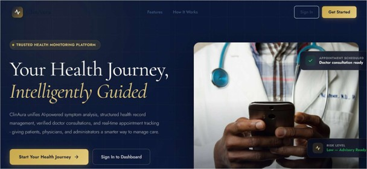

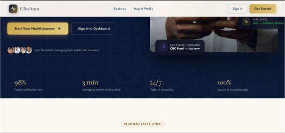

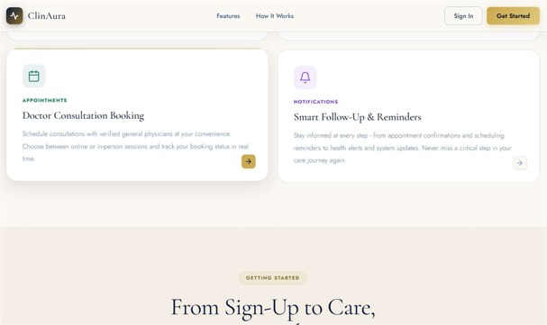

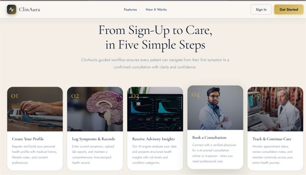

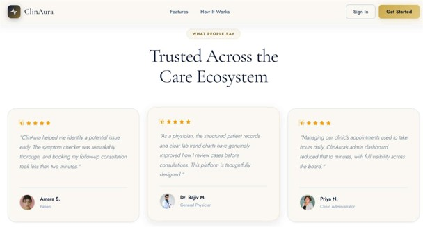

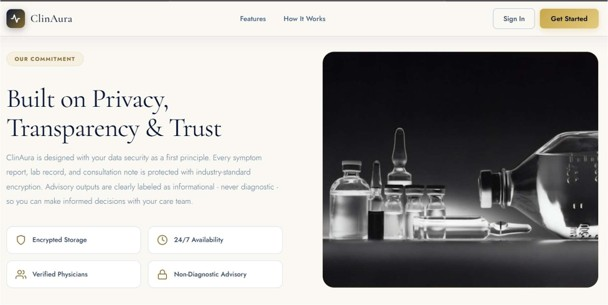

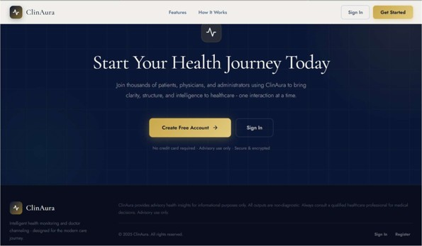

### 8.2 Patient Dashboard

The patient module provides interfaces for personal health monitoring, profile management, medical document access, symptom tracking, and appointment management.

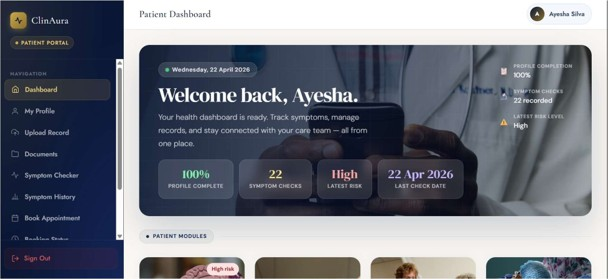

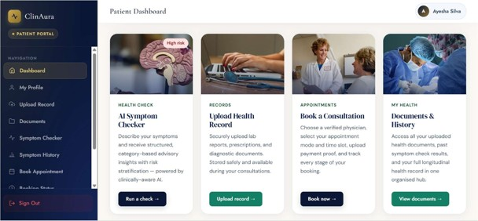

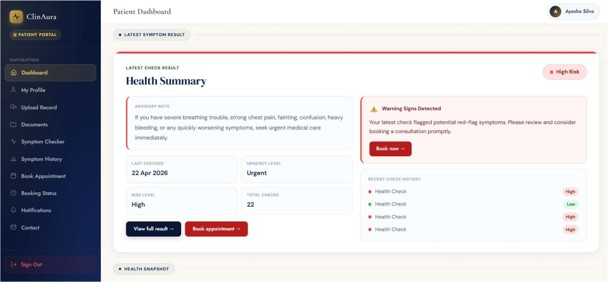

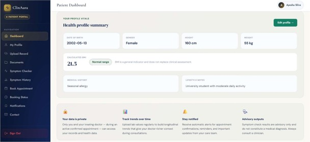

### 8.3 AI-Assisted Symptom Checker

ClinAura includes a structured symptom-checking interface supported by a Python-based Logistic Regression model.

The system generates category-based advisory outputs rather than medical diagnoses.

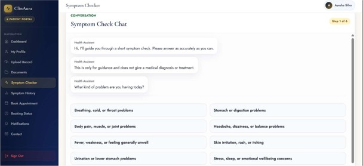

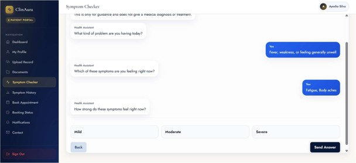

### 8.4 AI Symptom Prediction Results

The symptom checker presents predicted health-concern categories, probability values, and risk indicators.

These results are intended for educational demonstration and are not clinically validated.

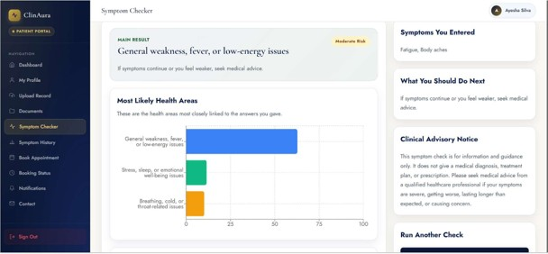

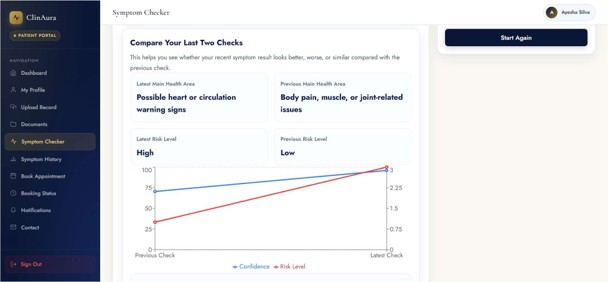

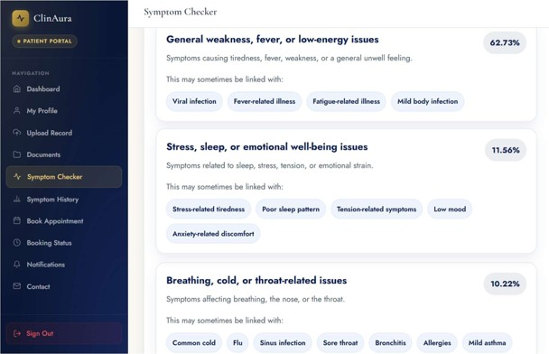

### 8.5 Health Document Management

The health document module allows patients to organize uploaded medical records and associated information.

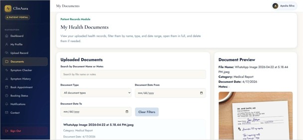

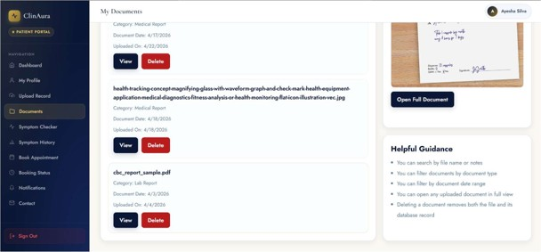

### 8.6 Doctor Appointment Booking

The appointment booking interface supports General Physician consultation requests and appointment status tracking.

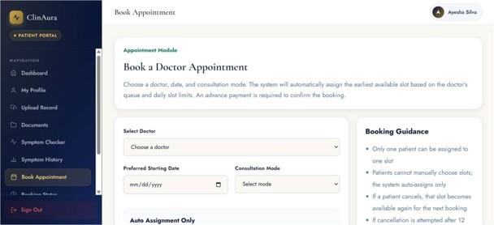

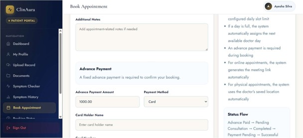

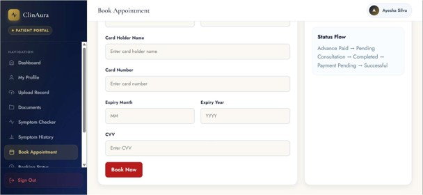

### 8.7 Doctor Dashboard

The doctor module provides interfaces for managing appointments, accessing authorized patient information, and coordinating consultation workflows.

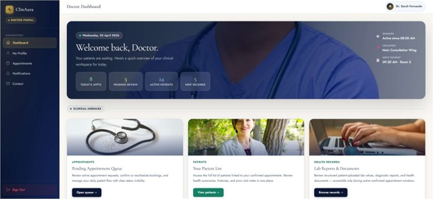

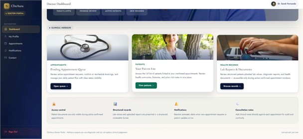

### 8.8 Administrator Dashboard

Administrators can access operational interfaces for managing doctors, monitoring appointments, handling inquiries, and reviewing healthcare-related system information.

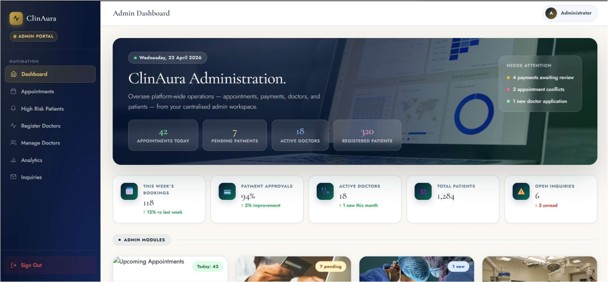

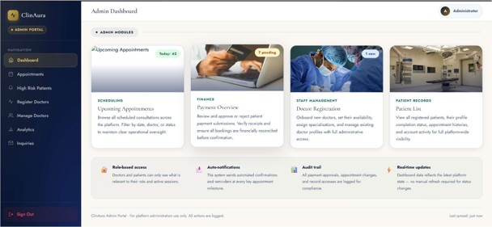

### 8.9 Administrative Operational Analytics

ClinAura's documented administrative analytics provide insights into system activity and operational workflows.

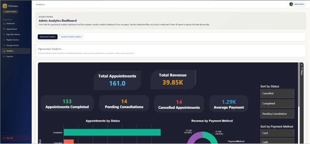

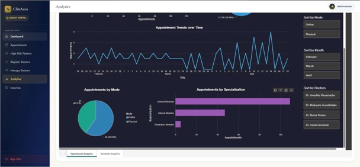

### 8.10 Symptom-Based Analytics

The system documentation also includes symptom-related dashboards for viewing aggregated monitoring patterns.

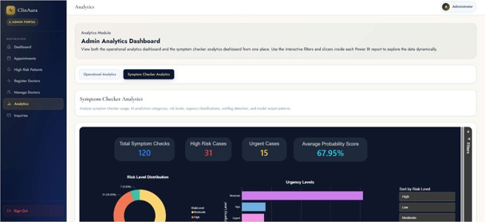

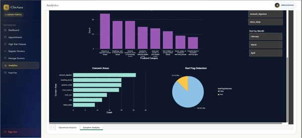

---

**Disclaimer:** The screenshots demonstrate interfaces and results from the academic project. ClinAura is not a clinically validated medical system, and its predictive outputs must not be used for diagnosis or treatment.


## 9. Project Management

Agile Project Management was selected for the project to accommodate iterative development, changing requirements, implementation challenges, and ongoing testing.

The work was organized into development phases involving:

- Requirements analysis
- Project planning
- Feasibility evaluation
- System architecture
- UI/UX design
- Frontend and backend development
- Machine learning integration
- Database implementation
- Testing and evaluation
- Documentation and final review

### Project Timeline


The final report also discusses deviations from the initial schedule, implementation challenges, and adjustments made throughout development.

---

## 10. Feasibility Study

The project includes a structured feasibility assessment across six areas.

| Feasibility Area | Evaluation Focus |
|---|---|
| Operational | Suitability of the proposed healthcare workflows |
| Technical | Frameworks, tools, architecture, and implementation requirements |
| Cost | Initial and ongoing project expenditure |
| Economic | Estimated costs and potential benefits |
| Schedule | Milestones, deadlines, and development feasibility |
| Ethical and Legal | Health-data privacy, responsible AI, and regulatory considerations |

These assessments support the academic evaluation of the project's practicality, risks, and scope.

The cost-benefit figures are academic estimates rather than independently verified commercial outcomes.

---

## 11. UI/UX Design

The project includes wireframes for the public interface and key user-role dashboards.

### Public Homepage Wireframe


### Patient Dashboard Wireframe


### Doctor Dashboard Wireframe


### Administrator Dashboard Wireframe


These design artefacts demonstrate interface planning before and during development.

---

## 12. Testing and Verification

The final report documents software testing and verification activities, including:

- Functional testing
- Input validation
- API testing
- Authentication-related test cases
- Patient workflow testing
- Doctor workflow testing
- Administrative workflow testing
- Machine learning functionality checks
- Integration testing
- Evaluation of expected and actual results

Testing evidence is documented in the final academic report.

The published source code has not been independently certified for production or clinical deployment.

---

## 13. Repository Structure

    ClinAura-Health-Monitoring-and-Doctor-Channeling/
    ├── frontend/
    │   ├── public/
    │   ├── src/
    │   ├── package.json
    │   └── package-lock.json
    ├── backend/
    │   ├── Controllers/
    │   ├── Data/
    │   ├── DTOs/
    │   ├── Helper/
    │   ├── Migrations/
    │   ├── ML/
    │   │   ├── artifacts/
    │   │   ├── data/
    │   │   ├── expand_dataset.py
    │   │   ├── predict_api.py
    │   │   ├── predict_utils.py
    │   │   ├── requirements.txt
    │   │   └── train_model.py
    │   ├── Models/
    │   ├── Properties/
    │   ├── Services/
    │   ├── Program.cs
    │   └── SystemBackend.csproj
    ├── login/
    ├── diagrams/
    ├── screenshots/
    ├── planning/
    ├── docs/
    │   ├── ClinAura_Final_Report.pdf
    │   └── ClinAura_Interim_Report.pdf
    ├── .gitignore
    └── README.md

---

## 14. Local Development

### Frontend

Install Node.js, then run:

```bash
cd frontend
npm install
npm start
```

### Backend

Install the .NET SDK compatible with the project's target framework.

```bash
cd backend
dotnet restore
dotnet build
dotnet run
```

Configure a local SQL Server connection and apply the project's database migrations as required.

### Machine Learning

Install a compatible Python environment:

```bash
cd backend/ML
pip install -r requirements.txt
```

The Python prediction service requires the appropriate model artefacts and configuration.

**Environment note:** The source archive may require further configuration and integration work. The commands above are starting points, not a guarantee that all documented modules run without modification.

Do not commit JWT signing keys, production database passwords, access tokens, or other private credentials.

---

## 15. Skills Demonstrated

### Full-Stack Development

- React.js
- JavaScript
- C#
- ASP.NET Core Web API
- REST API Development
- Database Integration
- Entity Framework Core
- SQL Server

### Artificial Intelligence and Data Analytics

- Python Programming
- Machine Learning
- Logistic Regression
- Dataset Preparation
- Model Training and Evaluation
- Prediction API Development
- Power BI Analytics

### Software Engineering and Project Management

- Requirements Engineering
- Agile Project Management
- Feasibility Studies
- Risk Assessment
- Cost-Benefit Analysis
- Database Design
- ER and Use Case Diagrams
- Data Flow Diagrams
- Wireframing
- Software Testing
- Technical Documentation

---

## 16. Project Documentation

The academic project was documented in two major stages.

### Interim Report

The interim report covers the initial research, literature review, system requirements, project planning, feasibility assessment, architecture, initial implementation work, and testing preparation.

[View Interim Project Report](docs/ClinAura_Interim_Report.pdf)

### Final Report

The final report documents the completed academic project, including project management, feasibility analysis, architecture, design diagrams, implementation, testing, evaluation, and future recommendations.

[View Final Project Report](docs/ClinAura_Final_Report.pdf)

---

## 17. Limitations and Future Improvements

ClinAura remains an academic demonstration system.

Key considerations include:

- The AI model is not clinically validated.
- Symptom predictions are category-based and non-diagnostic.
- The documented consultation workflow focuses on General Physicians.
- Real-world deployment would require additional security, privacy, reliability, and regulatory evaluation.
- The available source archive may not contain every module documented in the final report.

Future work may include improved model validation, broader doctor specialization support, automated testing, enhanced deployment infrastructure, and stronger healthcare interoperability.

---

## 18. Academic Context

ClinAura was developed as part of the **FC6P01 Project** academic module.

It demonstrates the application of software development, machine learning, system analysis, project management, feasibility evaluation, and technical documentation to a healthcare-oriented problem.

## Disclaimer

ClinAura is an educational software prototype, not a medical device or clinically approved healthcare service.

It should not be used to diagnose medical conditions, make treatment decisions, process real patient records, or provide emergency medical guidance.

The project documentation and source code are presented for academic and portfolio purposes.
